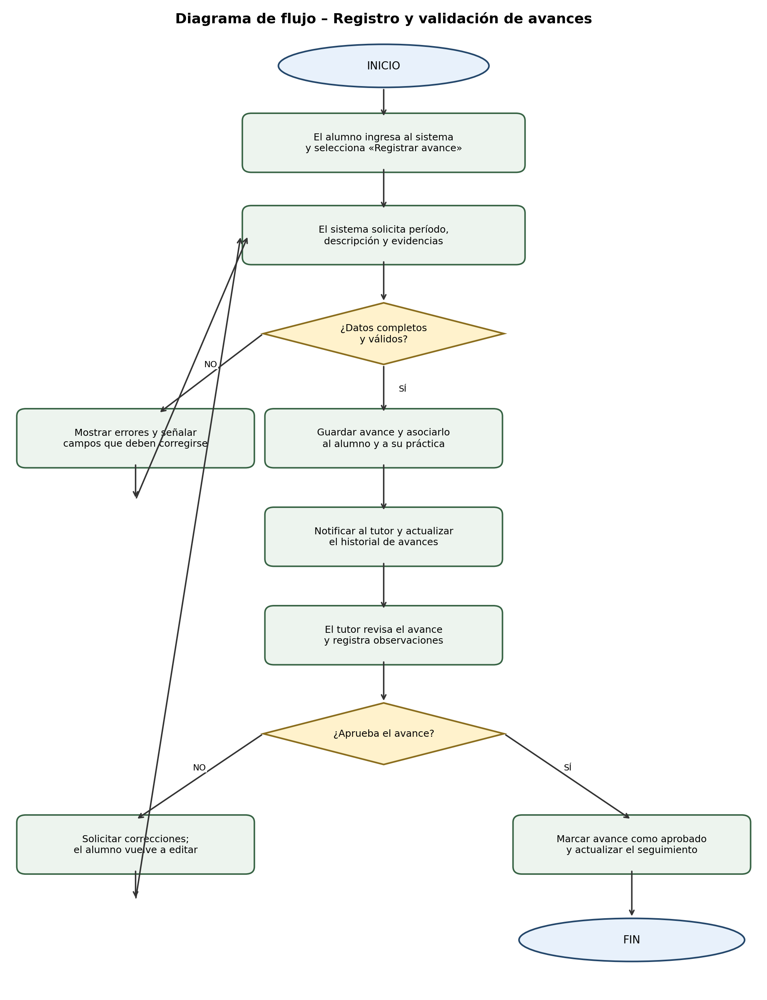
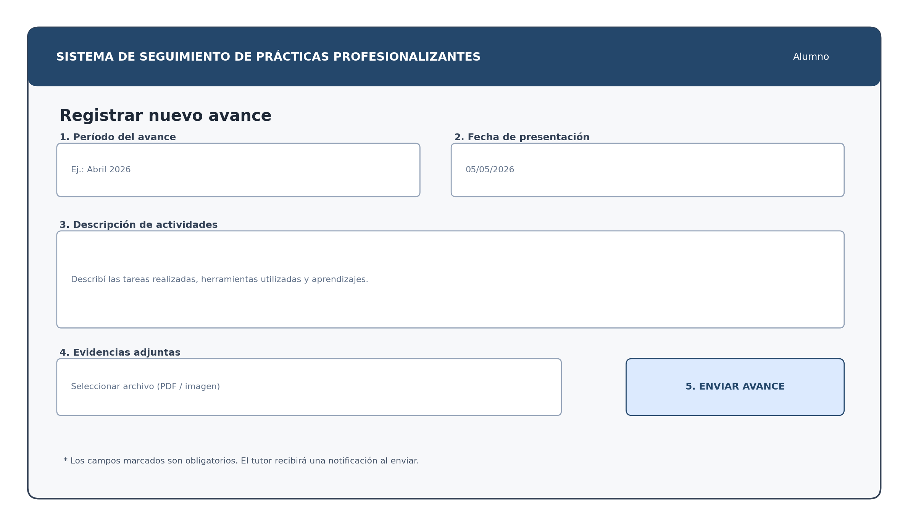

# Sistema de Seguimiento de Prácticas Profesionalizantes

Trabajo Integrador Individual · Modelos y Sistemas · 7.º año · Escuela Técnica

**Alumno:** Santiago Barreto

## Descripción

Este proyecto consiste en el desarrollo de un sistema informático destinado a gestionar y realizar el seguimiento de las Prácticas Profesionalizantes de los alumnos de escuelas técnicas.

El objetivo es facilitar la comunicación y organización entre alumnos, docentes, tutores y empresas vinculadas, permitiendo llevar un control de las actividades realizadas durante las prácticas.

## Objetivo general

Desarrollar una plataforma que permita registrar, organizar y supervisar el proceso de las Prácticas Profesionalizantes, mejorando el seguimiento de los alumnos y el control de sus actividades y entregas.

## Funcionalidades principales

- **Carga de avances periódicos:** registro de actividades realizadas, horas cumplidas y avances de cada alumno.
- **Registro de empresas:** almacenamiento de información de las empresas vinculadas con la institución.
- **Evaluación de tutores:** evaluación del desempeño de los alumnos por parte de los tutores responsables.
- **Control de entregas finales:** seguimiento de informes, documentación y trabajos finales.

## Usuarios del sistema

- **Alumnos:** registran sus avances y actividades.
- **Docentes:** supervisan y controlan las prácticas.
- **Tutores:** evalúan el desempeño de los alumnos.
- **Administradores:** gestionan empresas, usuarios y registros.

## Contenido del repositorio

```text
├── docs/
│   ├── README.md
│   └── Documentacion_Sistema_Seguimiento_Practicas_Profesionalizantes.docx
│
├── img/
│   ├── README.md
│   ├── diagrama_flujo_practicas.png
│   └── mockup_practicas.png
│
└── README.md
```

## Documentación desarrollada

### 1. Marco conceptual y clasificación
Diferencias entre documentación de usuario y documentación técnica, con ejemplos aplicados al sistema.

### 2. Documentación paso a paso
Instructivo para registrar y enviar un avance periódico de una práctica profesionalizante, incluyendo prerrequisitos, pasos, resultados y posibles errores.

### 3. Diagrama de flujo
Representación del proceso de registro, validación y aprobación de avances, contemplando caminos alternativos.

### 4. Caso de uso formal
Especificación del caso de uso CU-01: Registrar y enviar avance periódico, con actor principal, precondiciones, flujo principal y excepciones.

### 5. Interfaz del sistema
Mockup de la pantalla de registro de avances con referencias explicativas.

## Vista previa

### Diagrama de flujo



### Interfaz del sistema



## Documento completo

[Descargar documentación completa en formato Word](docs/Documentacion_Sistema_Seguimiento_Practicas_Profesionalizantes.docx)

## Estado del proyecto

Proyecto académico en etapa de planificación y documentación.

## Proyecto académico

Trabajo Integrador Individual de 7.º año – Escuela Técnica.

**Autor:** Santiago Barreto


